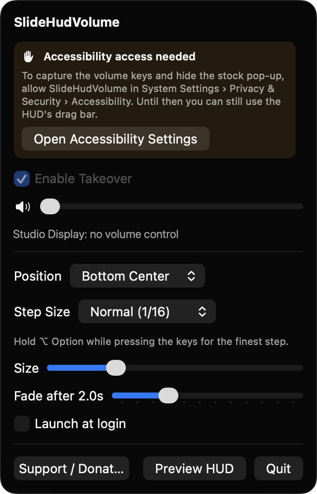
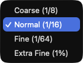

# SlideHudVolume

**🌐 Website:** [turhe123.github.io/slide-hud-volume](https://turhe123.github.io/slide-hud-volume/)

Replace the volume pop-up with a slim bar you can drag, and change volume in fine steps from your keys.

> 🆓 A free, open-source **VolumeGlass alternative** for macOS 14+. Native Swift, no accounts, no subscriptions, MIT licensed.


## Why

SlideHudVolume is a free, open-source, 100% native, backend-free alternative to paid utilities in the *Audio* category. It was inspired by VolumeGlass ($7.99 one-time), a nice take on a better volume indicator. SlideHudVolume has no accounts, no network access and no telemetry. It is a small SwiftUI/AppKit menu bar app that talks directly to Core Audio.

## Features

- **Volume key takeover**: intercepts the hardware volume up, volume down and mute keys with a session-level event tap, applies the change itself and hides the stock macOS overlay.
- **Selectable step sizes**: Coarse (1/8), Normal (1/16), Fine (1/64) and Extra Fine (1%).
- **Option key for the finest step**: hold ⌥ while pressing the volume keys to move by 1%.
- **Slim floating HUD**: a rounded material bar (about 220×44 pt at default size) with a speaker glyph that reflects the level, the output device name, and a percentage (or "Muted").
- **Click or drag to set an exact level** directly on the bar. The HUD stays up while the pointer is over it or while you drag.
- **Never blocks clicks**: the HUD is a non-activating panel that only accepts mouse events while the pointer is over it, and it floats over full-screen apps.
- **Menu bar controls**: Enable Takeover, a volume slider, position (Bottom Center, Top Center, Bottom Left), step size, HUD size (0.75×–1.75×), fade delay (0.5–6 s), Launch at login, Preview HUD and Quit.
- **Multi-display aware**: the HUD appears on the display that contains the mouse pointer, and is not shown while the screen is locked.
- **Follows changes from elsewhere**: Core Audio listeners keep the HUD in sync when volume or mute changes from other sources, and re-register when the default output device changes (for example when Bluetooth headphones connect).
- **Graceful fallback**: if the output device has no software volume (some HDMI monitors), the HUD shows "Device has no volume control" and the key press passes through to macOS untouched.
- **Works without permission**: without Accessibility access the HUD and its drag bar still work from the menu bar, but key capture is disabled.

## Screenshots

<p align="center"></p>

<p align="center"><em>The menu bar panel with takeover, a volume slider, HUD position, step size, HUD size, fade delay, Launch at login and Preview HUD.</em></p>

<p align="center"></p>

<p align="center"><em>The slim floating HUD shows the speaker glyph, the output device name, a draggable level bar and the percentage.</em></p>

<p align="center"></p>

<p align="center"><em>Pick how far each volume key press moves: Coarse (1/8), Normal (1/16), Fine (1/64) or Extra Fine (1%).</em></p>

## Install

1. Download `SlideHudVolume-macOS.zip` from the [latest release](https://github.com/turhe123/slide-hud-volume/releases/latest).
2. Unzip it and move `SlideHudVolume.app` to `/Applications`.
3. Because the app is open source and not notarized, clear the quarantine attribute:

   ```bash
   xattr -cr /Applications/SlideHudVolume.app
   ```

4. Right-click the app and choose **Open** the first time you launch it.

## Build from source

Requires macOS 14+ and Xcode with Swift 5.9+.

```bash
brew install xcodegen
xcodegen generate
xcodebuild -project SlideHudVolume.xcodeproj -scheme SlideHudVolume -configuration Release -derivedDataPath ./build build
```

The app is produced at `build/Build/Products/Release/SlideHudVolume.app`.

## Permissions

- **Accessibility** (required for key takeover): macOS requires it to create the event tap that captures the volume and mute keys and suppresses the stock overlay. The app prompts on first launch and then polls until access is granted. The menu has an **Open Accessibility Settings** button if you need it later.
- **Login item** (optional): only if you turn on *Launch at login*, which uses `SMAppService`.

The app does not use Screen Recording, Microphone or the network. It reads and sets the output device's volume and mute through Core Audio, which needs no permission prompt.

## Built with AI

SlideHudVolume was written by [Claude Code](https://claude.com/claude-code) inside an automated pipeline, from a plain-English spec. No code, binaries or assets from any commercial app were used; it is a clean-room reimplementation of a feature set, not a copy.

What that means in practice:

- The full source is in this repo under the MIT license. Read it before you run it.
- No network calls, no analytics, no third-party dependencies. Only Apple frameworks.
- Ad-hoc signed and not notarized, which is why Gatekeeper warns on first launch.
- It has had less human review than a hand-written app. Bug reports and pull requests are welcome.

## Support ❤️

If SlideHudVolume is useful to you, you can support its development:

[Support Or (Leo) Davidai ❤️](https://ko-fi.com/leodavidai)

The menu also has a **Support / Donate ❤️** button.

## More free Mac apps

SlideHudVolume is one of [60 free, open-source Mac utilities](https://github.com/turhe123/mac-apps) built the same way: native Swift, no accounts, no telemetry. Browse the full gallery at [turhe123.github.io/mac-apps](https://turhe123.github.io/mac-apps/).

## License

MIT © Or Davidai Bachar
